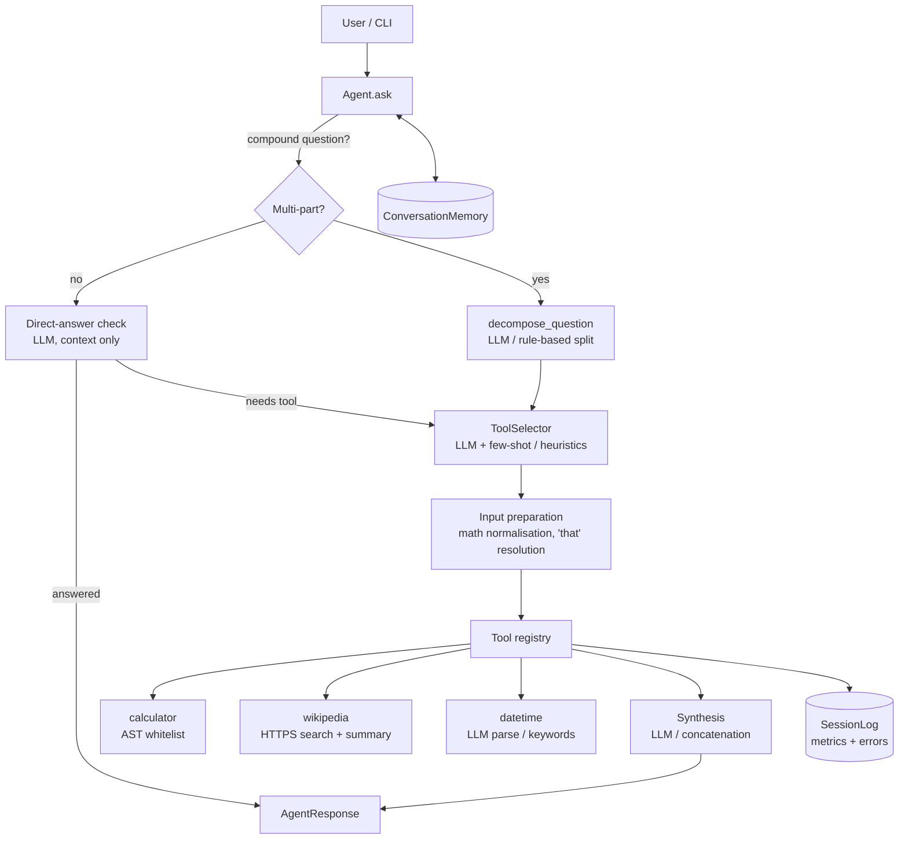

# Agentic Assistant

[](https://github.com/sandhyabhatt07/agentic-assistant/actions/workflows/ci.yml)


A multi-tool LLM agent that answers single and multi-part questions by decomposing them into sub-tasks,
choosing the right tool for each, executing the tools and synthesising one answer.

- **Task decomposition**: "what is 5 + 3 and also tell me about Python" becomes two tool calls and one answer.
- **LLM tool selection** with few-shot prompting and strict JSON validation; invalid output falls back to rules.
- **Works offline**: with no API key every LLM step has a deterministic, rule-based fallback.
- **Conversation memory**: follow-ups such as "multiply that by 2" resolve against earlier answers.
- **Safe by design**: the calculator is an AST whitelist (no `eval`), secrets are never logged, tool failures
  are contained and reported instead of crashing the session.
- **Observability**: structured per-session metrics (tool latency, success rate, errors) exported to JSON.
- **Production tooling**: packaged with `pyproject.toml`, typed (`mypy --strict`), linted (`ruff`), 85+ tests,
  an offline eval for tool-selection accuracy, CI on Python 3.10–3.13 and a Docker image.

---

## Quick start

```bash
git clone https://github.com/sandhyabhatt07/agentic-assistant.git
cd agentic-assistant
python -m venv .venv && source .venv/bin/activate   # Windows: .venv\Scripts\activate
pip install -e ".[dev]"

cp .env.example .env        # then set OPENAI_API_KEY (optional; see "Offline mode")
agentic-assistant           # or: python main.py / python -m agentic_assistant
```

Ask one question without entering the REPL:

```bash
agentic-assistant "what is 25 * 4"            # -> 100
agentic-assistant -v "what's the time and what is 100/5?"   # shows each tool call
agentic-assistant --offline "tell me about Ada Lovelace"
```

### Docker

```bash
docker build -t agentic-assistant .
docker run --rm -it --env-file .env agentic-assistant
docker run --rm agentic-assistant --offline "what is 6 * 7"
```

---

## Example session

```text
You: what is 10 * 5?
Agent: 50

You: multiply that by 2
Agent: 100

You: what is 5 + 3 and also tell me about Python
  [1] calculate 5+3 -> calculator('5+3') [ok]
  [2] get info about Python -> wikipedia('Python programming language') [ok]

Agent: 5 + 3 equals 8. Python is a high-level, general-purpose programming language...

You: divide 100 by 0
Agent: Error: division by zero
```

| Command             | What it does                                   |
|---------------------|------------------------------------------------|
| `help`              | Show commands                                  |
| `stats`             | Tool calls, success rate, latency, errors      |
| `memory`            | Last five interactions                         |
| `clear`             | Clear conversation memory                      |
| `export`            | Write session metrics to `agent_session.json`  |
| `multi: <question>` | Force multi-tool mode                          |
| `exit` / `quit`     | Exit (the session is exported automatically)   |

---

## Architecture



Every component receives its dependencies through the constructor (settings, LLM client, tools, memory,
session log), so each can be replaced or faked in tests. The LLM is behind a small `LLMClient` protocol, so
any OpenAI-compatible endpoint (Azure OpenAI, vLLM, Ollama, ...) works by setting `OPENAI_BASE_URL`.

### Project layout

```text
agentic_assistant/
├── agent.py            # Orchestration: routing, decomposition, execution, synthesis
├── selector.py         # Tool selection: LLM with few-shot prompt, rule-based fallback
├── llm.py              # LLMClient protocol + OpenAI implementation
├── memory.py           # Bounded conversation history
├── telemetry.py        # Logging setup and per-session metrics
├── config.py           # Settings loaded from environment / .env
├── parsing.py          # JSON extraction from LLM output, math normalisation
├── cli.py              # REPL and one-shot CLI
└── tools/
    ├── base.py         # Tool / ToolResult / ToolError
    ├── calculator.py
    ├── wikipedia_search.py
    └── datetime_tool.py
evals/                  # Labelled tool-selection dataset and eval runner
tests/                  # Unit and CLI tests (no network, no API key needed)
```

---

## Configuration

All settings come from environment variables (or `.env`); see [`.env.example`](.env.example).

| Variable              | Default              | Purpose                                              |
|-----------------------|----------------------|------------------------------------------------------|
| `OPENAI_API_KEY`      | *(unset)*            | Enables LLM features; unset means offline mode       |
| `OPENAI_MODEL`        | `gpt-4o-mini`        | Chat model used for every LLM step                   |
| `OPENAI_BASE_URL`     | *(OpenAI)*           | Any OpenAI-compatible endpoint                       |
| `REQUEST_TIMEOUT`     | `30`                 | Seconds per LLM request                              |
| `MAX_RETRIES`         | `3`                  | LLM retries with backoff on transient errors         |
| `MAX_MEMORY_SIZE`     | `50`                 | Interactions kept in memory                          |
| `CONTEXT_WINDOW`      | `3`                  | Recent interactions sent to the LLM as context       |
| `LOG_LEVEL`           | `INFO`               | Level written to the log file                        |
| `LOG_FILE`            | `agent.log`          | Log file path; empty disables file logging           |
| `CONSOLE_LOG_LEVEL`   | `WARNING`            | Level printed to the terminal                        |
| `SESSION_EXPORT_FILE` | `agent_session.json` | Where `export` writes session metrics                |
| `WIKIPEDIA_SENTENCES` | `2`                  | Sentences per Wikipedia summary                      |
| `WIKIPEDIA_LANGUAGE`  | `en`                 | Wikipedia language edition                           |

### Offline mode

Without `OPENAI_API_KEY` (or with `--offline`) the agent still works: tool selection uses keyword and
expression rules, compound questions are split on joining phrases ("and also", "?", ", and"), dates are
parsed from keywords and multi-part results are listed rather than synthesised.

---

## Adding a tool

```python
from agentic_assistant import Agent, ToolError


def weather_lookup(city: str) -> str:
    if not city.strip():
        raise ToolError("city is required")  # becomes a failed ToolResult, not a crash
    return f"Weather for {city}: Sunny, 22°C"


agent = Agent()
agent.add_tool("weather", weather_lookup, "Get the current weather for a city. Input: the city name.")
print(agent.run("what's the weather in Pune?"))
```

The description is what the LLM sees when choosing tools, so say what the tool does and what input it expects.
New tools are included in selection and decomposition prompts immediately.

---

## Development

```bash
pip install -e ".[dev]"
pre-commit install            # ruff + formatting on every commit

pytest                        # unit tests (offline, no API key)
pytest -m network             # live Wikipedia test
pytest --cov                  # coverage report
ruff check . && ruff format --check .
mypy                          # strict type checking

python -m evals.run_tool_selection             # tool-selection accuracy, offline heuristics
python -m evals.run_tool_selection --mode llm  # same dataset against the configured LLM
```

CI (GitHub Actions) runs lint, type checks, tests on Python 3.10–3.13, the offline eval (must stay above 90%)
and a Docker smoke test on every push and pull request.

---

## Troubleshooting

- **Multi-part question answered as one?** Join the parts with "and also", "and tell me", a comma + "and",
  or a second question mark, or prefix the question with `multi:`.
- **Wikipedia says "multiple results found"?** Be specific: "Python programming language" rather than "Python".
- **"could not reach Wikipedia"?** The tool needs outbound HTTPS to `*.wikipedia.org`.
- **LLM errors?** Check `OPENAI_API_KEY`, your quota and `OPENAI_MODEL`; details are in `agent.log`.
  The agent keeps answering with offline fallbacks while the API is failing.
